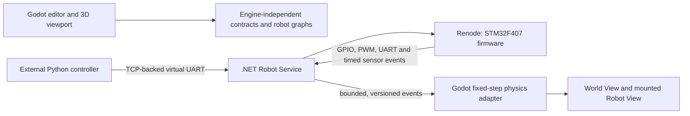
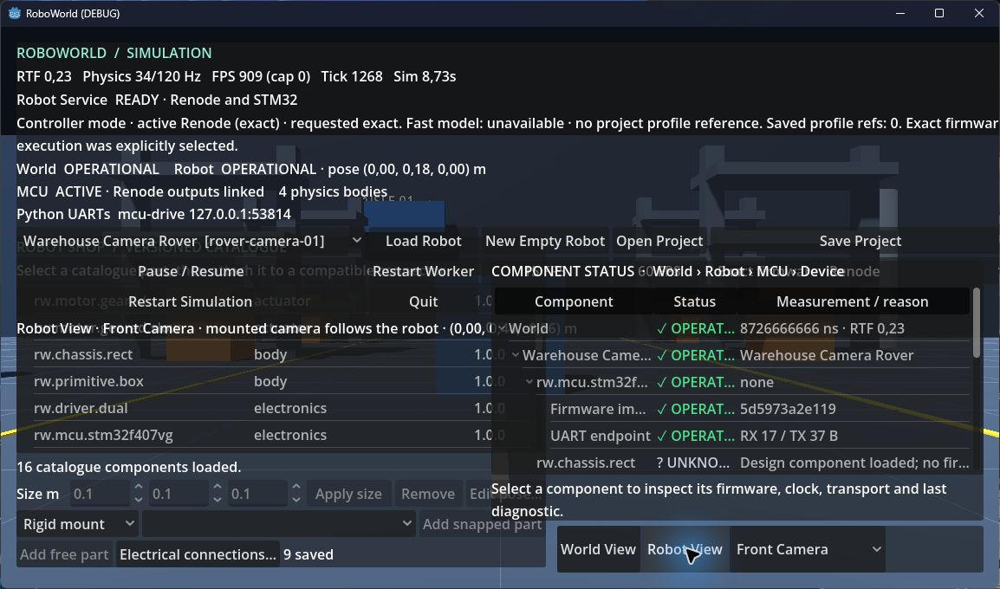

# RoboWorld

**An owner-directed robotics engineering project** exploring how real embedded firmware, robot construction, and 3D physics can work together in a desktop simulator.

RoboWorld combines a Godot .NET workspace with an engine-independent robot/component model and a .NET Robot Service that supervises Renode. A host-side Python controller sends commands through a virtual UART; compiled STM32 firmware interprets them, and validated peripheral outputs drive the simulated robot through Godot physics.

> RoboWorld is an engineering prototype, not a finished commercial simulator. The project owner, GeoBot985, directs the concept, vision, architecture, requirements, technology choices, development priorities, validation criteria, and acceptance decisions. AI tools have assisted implementation, automated testing, and documentation. The project does not claim that all code was manually written.

## Engineering problems

RoboWorld investigates several connected systems problems:

- Keeping a robot's persistent component model independent from the 3D engine.
- Routing mechanical joints and typed electrical connections through explicit graphs.
- Executing actual compiled STM32 firmware instead of translating user commands directly into physics actions.
- Coordinating an emulator clock with fixed-step physics while rendering runs independently.
- Returning simulated sensor inputs through firmware-visible peripherals.
- Letting users edit and persist incomplete robot designs without weakening runtime validation.

## Architecture



The current source is organized as `RoboWorld.Contracts`, `RoboWorld.Domain`, `RoboWorld.RobotService`, and the Godot adapter project. Persistent component definitions and robot/world manifests contain no Godot objects. The physics adapter turns validated graphs into Godot bodies and joints. Python runs as a host process; firmware runs inside Renode.

The Exact Renode path is the reference execution path. An experimental deterministic controller backend exists, but broad fidelity and performance qualification remain incomplete. See [architecture notes](docs/architecture/overview.md) and [validation results](docs/validation.md).

## Implemented features

- Versioned component catalogue, mechanical link/joint graph, typed electrical graph, validation, and project-package persistence.
- Empty and incomplete robot drafts with save/reopen, component editing, connector snapping, and launch-readiness checks.
- Versioned warehouse objects with visual geometry and collision definitions.
- Robot-mounted camera with World/Robot view switching in the Godot workspace.
- Cortex-M4 firmware examples for the STM32F407VG, built from C and loaded by Renode.
- UART-controlled firmware actuation routed through peripheral outputs into Godot motor and rigid-body physics.
- A firmware-visible distance-sensor path driven by Godot raycasts and timed MCU input pulses.
- Diagnostics and regression tools for faults, timing, project persistence, and assembly graphs.

These are measured prototype capabilities; broader device support, calibrated sensors, camera-frame streaming to user code, and clean-machine product packaging are not claimed.

## Screenshot

This is a genuine Godot application capture of the mounted camera view during a simulation run.



## Installation and usage

The repository contains source, tests, examples, and pinned toolchain metadata. It does not bundle Godot, Renode, .NET, Arm GCC, or a ready-to-run application binary. Start with [Developer setup](DEV_SETUP.md) and the [toolchain lock](toolchain.lock.json).

After installing the pinned tools and placing them in the documented local `.toolchain` paths:

```powershell
python -m venv .venv
.\.venv\Scripts\python.exe -m pip install -r python/requirements.txt
.\tools\build.ps1
.\tools\run-godot.ps1
```

The sample firmware must be built with the pinned Arm GNU toolchain before a firmware-driven run. The simulation supervises Renode and the Robot Service from the application path; the sample controller can be run separately from the host with `samples/controller/main.py`.

## Testing and validation

The current Windows validation includes a Release solution build, **161 domain assertions**, **27 Robot Service assertions**, and schema/semantic validation of **24 example JSON documents**. Firmware-driven acceptance checks cover UART protocol handling, STM32 PWM/GPIO actuation, robot motion, sensor return, camera follow, and warehouse collision queries. Measured scope and limitations are in [validation results](docs/validation.md); reproducible test scripts are under `tools/`.

## Current limitations

- The project has no downloadable installer or clean-machine release qualification. The local toolchain is intentionally not committed.
- Godot physics and Renode remain coupled by an acknowledged fixed-step path; measured real-time factor depends on workload and host.
- The Renode socket UART transports bytes but does not model 115200-baud wire serialization. Sensor timing/accuracy is not a calibrated hardware model.
- The mounted camera currently provides a local Godot Robot View. A bounded camera-frame transport to the host controller is not implemented.
- Coordinated runtime checkpoint/resume is deferred. Project/design persistence is separate from runtime state.
- The experimental fast controller backend, multi-controller scaling, broad repeatability, and performance targets are not fully qualified.
- Windows 11 x64 is the verified desktop target; Linux has not been validated.
- Cloud multiplayer, sandboxed cloud execution, a broad commercial component catalogue, and AI world authoring are future work.
- The repository currently has no project license. See [third-party notices](THIRD_PARTY_NOTICES.md).

## Development roadmap

Near-term priorities are to finish clean-machine packaging and performance/fidelity qualification, improve repeatability of sensor and motion results, and expand measured tests for controller and peripheral combinations. Later work may add camera-frame delivery, more reusable assemblies, additional physical device models, and educator-focused workflows. Cloud worlds and AI-assisted scene authoring remain future directions.

See [Roadmap](docs/roadmap.md) for scope and acceptance boundaries.

The curated single-commit publication and contribution attribution are explained in [release provenance](docs/provenance.md).
