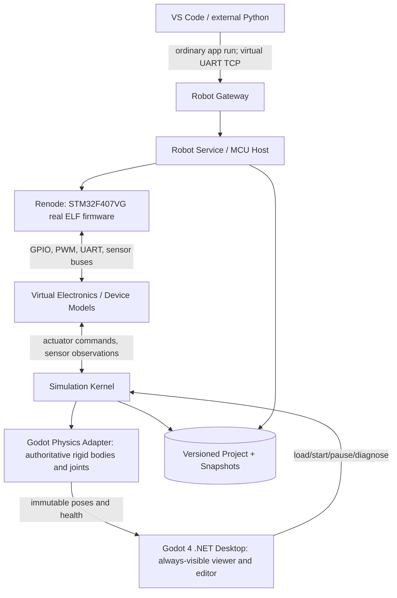

# 01 — System architecture

## 1.1 Architecture intent
Build one Windows desktop application in the user experience, composed internally of modular workers. In P0 Godot 4 .NET supplies both the **authoritative physics** and the **visible 3D rendering**; a .NET Robot Service supervises Renode and virtual electronics. Domain/catalogue modules do not import Godot. A future cloud deployment may run the same Godot physics project as a non-visual authoritative process, but clients must always have a visible viewer; **no headless user mode is offered**.

## 1.2 Context view

Note: Diagram shows responsibilities, not necessarily independent processes. The local Godot app hosts its simulation kernel and physics adapter; the .NET Robot Service/Renode runner is a managed child process. World-to-hardware bridge is an internal, versioned, local transport. Do not send ordinary Python controls directly to physics.

## 1.3 Process topology P0
| Process | Ownership | Main responsibilities | Not allowed |
|---|---|---|---|
| `RoboWorld.exe` (Godot 4 .NET exported app) | UI/launcher/simulation coordinator | Visible 3D world, authoritative Godot physics, assembly editor, save/open UX, supervisor, world ↔ worker bridge | Interpret firmware-level app commands or directly bypass MCU |
| `RoboWorld.RobotService` (.NET x64 child) | electronics/gateway | Start/monitor Renode, UART endpoints, virtual devices, event scheduler, diagnostics, reset/reload, bounded channels | Write arbitrary world transforms |
| Renode child process(es) | firmware execution | Execute exact ELF for STM32 target, expose validated CPU/peripherals and optional GDB | Run user's host Python |
| User's `python main.py` | external developer | Planning, AI, IK and commands through UART protocol | Access Godot authoritative mutation endpoints |

Use a single launcher that starts, monitors and shuts down services. Multiple MCUs are logical instances (Renode machines or independently managed workers) subject to measured resource constraints.

## 1.4 Canonical library ownership / dependency rule
```text
RoboWorld.Contracts     (C# records, schemas, protobuf types; pure)
RoboWorld.Domain        (catalogue, links/joints, validation, SI math; pure)
RoboWorld.Simulation    (clock contracts, scheduler, events; pure .NET)
RoboWorld.Devices       (DC motor, sensor, servo models; depends Domain/Simulation)
RoboWorld.Gateway       (local endpoint management, auth, packets)
RoboWorld.McuHost       (Renode process control + peripheral bridge adapters)
RoboWorld.Godot         (Godot SceneTree, physics adapter, rendering, UI)
RoboWorld.Desktop       (startup supervisor and project UX integrated with Godot)
RoboWorld.PythonClient  (optional convenience client; plain sockets also valid)
```
Do not make `.Domain` or `.Devices` depend on Godot/`Node3D`, `RigidBody3D`, Renode internals, Windows registry, or Google Cloud APIs. `McuHost` may depend on Renode abstractions but cannot leak them into canonical catalogues.

## 1.5 Authority model
- **World physical truth:** Godot Physics Adapter. Position, orientation, velocities, contacts, forces, raycasts.
- **MCU firmware truth:** Renode CPU/peripheral state. GPIO output, UART bytes, registers, interrupts as supported.
- **Electrical/device truth:** Robot Service Device Models. Physical motor law, encoder quantization, sensor sample process, power/logic constraints.
- **Canonical persistent design truth:** versioned `project.json`, `robot.json`, `world.json`, component catalogue.
- **UI truth:** none. UI displays snapshots and submits authorized edits/commands. UI cannot infer 'running' from movement or synthesize motor action.
- **Control application truth:** external user's code; control messages only, not direct world access.

## 1.6 Critical write / read sequence
1. User Python writes raw protocol bytes to local virtual UART endpoint.
2. Gateway buffers bytes and schedules them at hardware-modeled arrival times, preserving order and overflow policy. If native Renode UART socket bypasses this scheduler, mark bandwidth fidelity `UNVERIFIED` until proved/bridged.
3. Firmware running in Renode reads bytes via actual emulated UART, parses and changes timer/GPIO outputs.
4. Peripheral bridge emits timestamped PWM/direction output events to electronics model.
5. Electronics model computes output voltage/torque using component profile; requests an actuation through Godot Physics Adapter at next defined physics boundary.
6. Godot resolves physical motion. Sensor geometry queries return distance/velocity/contact.
7. Virtual sensor produces register/signal events subject to its sample period, range and noise. MCU firmware reads through actual validated peripheral path and sends telemetry on UART.
8. Python reads telemetry from its external process.
**Do not shortcut steps 2–7 with a direct `MOVE` handler.**

## 1.7 Engine-independence seam
The `IPhysicsWorldAdapter` interface is deliberately minimal. Recommended methods (logical signatures only):
```csharp
interface IPhysicsWorldAdapter {
  void Instantiate(AssemblyGraph design, WorldDefinition world);
  void ApplyActuators(IReadOnlyList<ActuatorCommand> commands, long simTimeNs);
  void AdvanceFixedStep(long startNs, long dtNs); // feasibility depends on Godot host scheduling
  PhysicalSnapshot CaptureState(long simTimeNs);
  SensorObservation QuerySensor(SensorQuery query, long simTimeNs);
  void RestoreState(PhysicalSnapshot snapshot);
}
```
Implementation MUST document whether `AdvanceFixedStep` can be explicitly driven by Godot (or instead is invoked through Godot's engine physics callback). If callbacks are engine-owned, use a stepping adapter and state machine; **do not invent an unsupported manual stepping API**. The adapter maps canonical link/joint IDs to Godot handles and returns engine-independent state.

## 1.8 Local vs future cloud
| Concern | Local P0 | Future multiplayer |
|---|---|---|
| Physics authority | Local Godot host | Godot world-authority instance on server |
| View | Local 3D viewport | Desktop subscribers to replicated state |
| User Python | User's machine | Optional isolated player sandbox in cloud |
| Firmware | Renode child | Per-player isolated MCU worker(s) |
| World store | Project folder | Durable world state + object store |
| Transport | Loopback | Authenticated network boundaries + internal IPC |
| Timing | One sim clock | One authoritative clock per world/shard |
| Ownership | Local user implicitly | World/user/robot/resource ACLs |

## 1.9 Deployment strategy
- First-run launches 3D window immediately with placeholder world/loading status while children initialize; no blank screen waiting for workers.
- No always-on Windows Service; Robot Service lifecycle scoped to RoboWorld app in P0.
- Expose one discoverable stable **logical** endpoint per robot; actual localhost ports can be ephemeral and stored in session discovery manifest (no port collisions).
- P0 viewer and physics share Godot process, but communicate internally through events/snapshots, never direct UI-to-physics writes.
- In future the physics-authority Godot runtime may use a windowless deployment but users still see a local rendered world. The requirement against 'headless mode' applies to **user experience**, not server infrastructure.

## 1.10 Explicit design risks
- The tested Godot/Renode synchronization path does not establish lockstep behavior for every workload; broader performance and recovery tests remain necessary.
- A Renode board script does not guarantee PWM, I²C or exact cycle timing work. Every firmware-visible peripheral needs a validation gate.
- Future physics engine replacement would still require substantial adapter work and re-validation; the *models/data* remain portable, not effortless physical equivalence.
