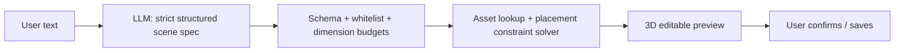

# 06 — World objects, semantics and AI-assisted environments

## 6.1 Core world concept
A world is a physical environment, not merely a collection of images. World objects can have collision geometry, friction, mass, interaction semantics, scripted deterministic dynamics and machine-readable capabilities. All positions are canonical SI metre coordinates; world objects are versioned assets independent of Godot scenes.

## 6.2 Starting world catalogue
- Geometry: room, floor, wall, doorway, ramp, table, shelf, pallet, obstacle, glass/cup.
- Robot-testing fixtures: line-follow track, obstacle course, maze, docking/charging bay.
- Future operational objects: conveyor, elevator, loading dock, warehouse rack, package, moving forklift, controlled gate, manufacturing station, task generator.
- Object props include `asset_ref`, transform, collision type, material/friction, tags, semantic roles (`support_surface`, `obstacle`, `pickable`, `charging_station`, etc.), motion/script bindings.
- A table has a `top_surface` anchor calculated from actual dimensions. A glass placed 'on table' gets physically supported placement with collision clearance, not guessed global coordinates.

## 6.3 AI world generation pipeline (MVP, not P0)

**Example request:** 'Give me a 20 m x 20 m room with a table and a glass on the table.' Resolve to a room width 20, depth 20 and chosen/declared height, one table anchored on floor and one glass placed on table top. If height is unspecified default 3 m and label as assumed; allow user adjustment.

## 6.4 Safety, correctness and limits
- AI can only choose from allowlisted asset/behavior definitions and edit scene data. It must not author unrestricted executable code inside the simulation core.
- Validate room sizes, object count, physical dimensions, non-overlapping placements, support relationships, reachability, hidden items and a performance budget before accepting.
- Ensure a deterministic spec with fixed random seed. Maintain prompt and generation provenance optionally; don't require online AI for normal offline worlds.
- Do not implicitly execute generated scene instructions as shell commands or load unknown remote assets with privileges.
- Export and edit scene YAML/JSON; no hard dependency on specific LLM provider. Provide manual templates as fully functional offline alternative.

## 6.5 Render and sensor representation
- Viewport display and robot camera are separate: robot camera orientation, field-of-view, exposure/fps, resolution/noise and capture timing are component properties.
- Use a Godot `SubViewport`/camera approach for first RGB sensor proof, subject to GPU readback/performance benchmark. Robot-camera frames may be available to user programs through a **direct** simulated USB/video endpoint, not forced through UART/MCU unless the selected hardware actually uses that path.
- Physics raycasts support ToF/ultrasonic approximation; define fields-of-view, range limits, update period and noise explicitly. Rendering FPS must not define sensor sample rate.
- For multi-user worlds, cameras must be simulated by server-authoritative sensor logic or faithfully delivered sensor frames; the visual client's spectator camera is **not** trusted sensor input.

## 6.6 Warehouse/factory test scenario
Scenario manifest includes warehouse 60 × 40 m, storage racks, lanes, loading bays, charging stations, actor paths, packages and robots, with deterministic task generation. Semantic event log: `job_created`, `picked`, `delivered`, `collision`, `charge_started`, `robot_fault`. User algorithms judged on completion time, throughput, collisions, energy, deadline adherence and resource utilization. Store per-run firmware/app versions, scenario hash and seed for fair algorithm comparisons.

## 6.7 State ownership
World scene is persisted independently from Godot `.tscn`; Godot scenes can be derived and cached for visual and collision representation. A renderer replacement should not invalidate semantically modeled rack, conveyor, table or glass assets.

## 6.8 P0 constraints
Create a fixed room and simple obstacle, with table/glass only if they aid visual/sensor tests. No AI integration required. Implement versioned world schema and a fixed-seed loader to prove the future pipeline is possible.
