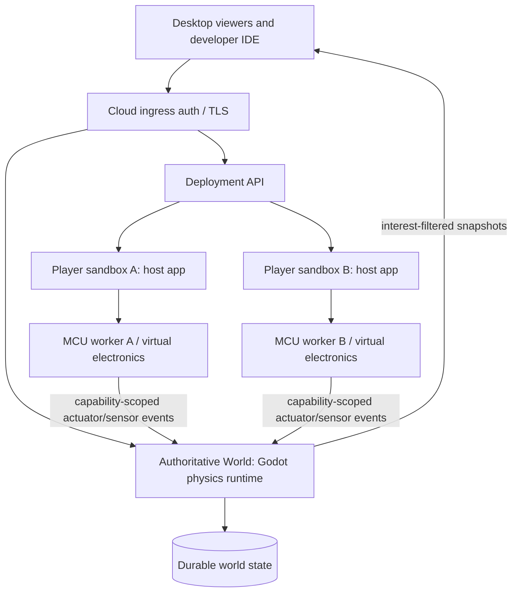

# 09 — Security model and future multiplayer/cloud architecture

## 9.1 Trust boundaries
- User-origin host Python is **untrusted** relative to world authority, even when executed locally in P0. It controls only assigned robot interfaces.
- User-submitted compiled MCU firmware is **untrusted** input to emulator. Emulator has no privileged filesystem/network authority; future cloud requires stronger isolation than merely running Renode as a process.
- User-created world/project manifests and AI-generated specs are untrusted data; schema validate, restrict paths/asset counts and never execute arbitrary script payloads.
- Multiplayer spectators receive authorized snapshots; must never directly edit world state.

## 9.2 Local P0 controls
- Bind firmware UART endpoint and internal API to `127.0.0.1` with ephemeral port discovery; do not expose Renode privileged monitor/GDB publicly.
- Use per-session capability token on **control/admin** APIs; raw virtual serial endpoint must be assigned to one robot/session and default private to local host. Avoid credentials in logs.
- Limit inbound packet sizes, command rates, queue depth, firmware file sizes, asset counts and manifest recursion.
- Subprocess: restricted working directory, known binary path, no shell command interpolation; use argument arrays. Job/process group termination on app close, health/restart with bounded policy.
- No open remote downloads or arbitrary plugins in P0.

## 9.3 Future multiplayer authoritative model

Physics authority is unique per world/shard; client rendering is never authoritative. Player code executes inside per-player sandbox with restricted CPU/RAM/I/O/storage/network and no direct authority APIs. MCU emulation may require its own nested or adjacent isolation because emulator vulnerabilities and CPU resource abuse are possible.

## 9.4 Cloud design principles (not P0 implementation)
- `world_id`, `player_id`, `robot_id`, `controller_id`, `sandbox_id` globally unique stable UUIDs.
- User belongs to world via role: owner/editor/robot-operator/viewer; robot ownership and resource quotas explicit.
- Upload manifests pin dependencies and firmware hashes; build artifacts signed or verified. Treat all source code and ELF files as untrusted.
- Player slot launches isolated host app and MCU workers; route robot-specific UART/peripheral endpoints locally to corresponding worker. Network and resource policies prohibit cross-player device access.
- Dedicated world server on Google Cloud (Compute Engine VM first; orchestration later on GKE if justified). Do not assume Cloud Run is ideal for permanently running physics worlds.
- Future design should include spectator view, robot release/retrieve, persistence, connection loss policies, bounded world tick load and billing quotas.

## 9.5 Untrusted software policy
Sandbox escape mitigation requires defense-in-depth: isolation (e.g., VM or appropriately sandboxed containers), unprivileged runtime user, seccomp/runtime restrictions as suitable, CPU quotas, memory/IO quotas, read-only root, restricted egress, deny host mounts and host sockets, per-world ACL enforcement, audit logs and versioned images. No claim of perfect safety from a single container flag.

## 9.6 Multiplayer timing and cheating
- Cloud player application should execute close to emulated MCU to minimize WAN control latency while MCU hardware/bus timing remains realistic.
- Remote local host apps can also connect if permitted; network latency is then real and must not be concealed.
- Clients only submit permitted commands; transforms, collision states and sensor readings are server-authoritative. Sensor capture for computer vision must come from simulation-side camera pipeline, not a player's rendered viewpoint.
- Simulation clock belongs to world authority; paused/overloaded worlds slow coherently and broadcast RTF.

## 9.7 Future educational safety/privacy
For school accounts, add age-appropriate defaults, content moderation for public world names/asset uploads, data minimization, role separation, parental/school controls and regulatory/legal review before deployment. **Do not implement account systems in P0.**
