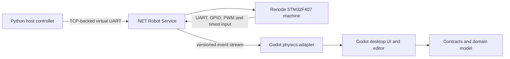

# Architecture overview

This document describes current system boundaries. Proposed product directions are marked as future work; measured implementation status and limits are recorded separately in [validation](../validation.md).

## Components

- **Contracts** define versioned schemas and the inter-process Protobuf messages.
- **Domain** owns catalogue definitions, robot and world graphs, authoring drafts, validation, persistence, and controller model data. It has no Godot dependency.
- **Robot Service** starts Renode, exposes the host UART endpoint, translates supported peripheral state into bounded event messages, and reports lifecycle/fault status.
- **Godot** owns the visible desktop workspace, editor projection, rigid bodies, joints, world rendering, and the fixed-step physics adapter.
- **Host controller** is an ordinary external Python process. It sends UART bytes and does not write physics state.

## Runtime path

The Exact path executes a compiled STM32F407 firmware image in Renode. The firmware parses the UART protocol and configures the emulated peripherals. Robot Service observes validated timer/GPIO state and forwards versioned events; Godot applies the corresponding device and physics behavior. Sensor observations travel in the opposite direction through a timed firmware-visible input and return over UART.

Godot fixed physics and Renode advancement are coordinated at explicit integer-nanosecond boundaries. Rendering is not the authoritative simulation clock. When the fixed-step handshake is slower than real time, real-time factor falls; correctness is not claimed to be independent of workload.

## Authoring and persistence

Robot definitions are versioned, engine-independent graphs. Authoring drafts may be empty or incomplete and can be persisted independently from runnable project packages. At launch, readiness validation checks the draft against the existing runnable graph requirements. A validated graph then uses the same package loader, firmware assignment, Robot Service, and simulation path as an existing project.

Mechanical links/joints and typed electrical connections are distinct graph relationships. A failed launch does not turn incomplete definitions into runtime placeholder parts.

## Scope boundaries

The Robot View renders the selected mounted camera inside the Godot desktop viewport. A host-side camera-frame API is not implemented. Coordinated simulation checkpoint/resume, cloud-hosted worlds, and cloud sandbox execution are future work. The deterministic controller backend is experimental and does not replace the Exact Renode acceptance path.
